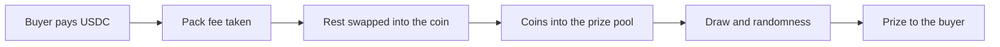

A **Fan coin machine** is a Gabox machine on a coin that already exists and trades, such as BONK or JUP. Buyers open packs on it like on any other machine, and each pack can win a multiple of the coins it bought. Nobody launches a new coin. The coin keeps trading wherever it already trades. The program calls this kind of machine a token machine.

## How it differs from a new-coin machine

| | New-coin machine | Fan coin machine |
| --- | --- | --- |
| The coin | A new coin, launched with the machine | A coin that already exists |
| Where the coin trades | Gabox's bonding curve, then a pool after graduation | Wherever it already trades |
| Transfer hook | Yes, until graduation | No |
| Machines per coin | One | Many |
| Paired with | USDC, SOL, a stock token or another registered token | Always USDC |
| Pack fee | 0.50% | 2% |
| What the creator earns | Part of the trading fee | Part of every pack fee |
| Mega Pack | After graduation | No |

## Which coins can have one

The program checks the coin when a machine opens. It accepts:

- a classic SPL token with no freeze authority; or
- a Token-2022 token with no mint authority and no freeze authority. Its only extensions may be metadata and group extensions. A transfer hook is allowed only when it does nothing, as on a graduated Gabox coin.

USDC itself cannot have a machine.

## One coin, many machines

Anyone can open a machine on a coin that passes these checks, as many times as they like. Each machine has its own address, its own prize pool, its own prize table and its own page at `https://gabox.fun/<machine address>`. Two machines on the same coin share only the coin.

So a machine's name tells you little. Check the coin's address before you buy. In the app, coins on Jupiter's verified list, and \$GABOX, carry a blue mark.

## Opening one

The creator chooses two things:

- **The top prize.** In the app, from 3× to 20× the pack coins. Each choice comes with its own table of Common, Rare, Epic and Mythic rows. Every table pays back about 0.95× to 0.955× of a pack on average, so no choice is a better deal. A higher top prize comes with smaller wins most of the time. The 8× choice is [the app's default table](/prizes-and-odds#the-apps-table).
- **The seed.** The creator's own coins. They move into the prize pool when the machine opens. There is no buy and no swap at launch. The program only needs a seed above zero. The app sizes the seed in US dollars and asks for at least \$20 of the coin.

The seed never comes back. It belongs to the prize pool for ever, as on a new-coin machine. See [Seed and jackpot](/seed-and-jackpot).

## How a pack works

1. You pay the pack price in USDC. Packs have a fixed range of USDC prices.
2. The program takes the 2% pack fee from the price.
3. The rest is swapped into the coin in the same transaction. In the app, Jupiter finds the swap route. The app sets the fewest coins you accept, `min_net_tokens`, so the purchase fails rather than buy fewer.
4. All the bought coins go into the prize pool. They are your pack coins: every prize is a multiple of them.
5. From here the pack works like any other. Your draw keeps its own copy of the prize table, MagicBlock picks the ticket, and the prize goes to your coin account. The prize pool caps a prize the same way. See [Opening a pack](/opening-a-pack) and [Always funded](/always-funded).

If any step fails, the whole transaction fails and nothing moves. A late draw can be retried or expired the same way. See [If the draw is late](/if-the-draw-is-late).

## Where the pack fee goes

The pack fee is 2% of the pack price. It is inside the price and paid in USDC.

| Part | Share of the price | Paid to |
| --- | ---: | --- |
| Creator | 1.20% | The machine's creator |
| Referrer | 0.30% | The buyer's referrer. With no referrer, the creator. |
| Gabox | 0.50% | Gabox |

A Fan coin machine has no Gabox market, so its creator earns no trading fee. Instead the creator earns part of every pack. Referral links work as on new-coin machines. Each wallet claims its USDC fees from its profile. See [Referrals and earnings](/referrals-and-earnings).

## Keeping or selling a prize

A prize arrives as the coin. You can keep it. In the app you can also sell it for USDC. The app swaps it through Jupiter. The swap includes a 0.15% Gabox fee. A sale is your own trade at the market price, so its result can be lower than the value the app showed.

## Funding and withdrawing prizes

Only the machine's creator can add more prize coins (Fund prizes in the app) and take them back (Withdraw prizes). The rules are the same as on a new-coin machine: never more than the creator added, never the seed, and only while no pack is opening and no prize is owed. See [After launch](/launch-a-machine#after-launch).

## Gifts

You can send a pack on a Fan coin machine as a gift. The gift holds its USDC until it is opened. The opening pays the same 2% pack fee as a purchase. See [Gift packs](/gift-packs).

## In the app

- **Launching.** "Fan coin" on the launch page opens one. It is open to everyone.
- **The machine list.** A Fan coin machine shows on the home list once its free prize pool is worth at least \$10. Its own page works from the start.
- **The leaderboard.** It ranks wallets by packs opened only. It does not list the coin's largest holders, because most of them never used this machine.

## Status

Fan coin machines are live on Solana mainnet. The program added them on October 20, 2026, for classic SPL coins and then for Token-2022 coins. Creator withdrawals followed on October 21, 2026. See [Status and addresses](/status-and-addresses).
