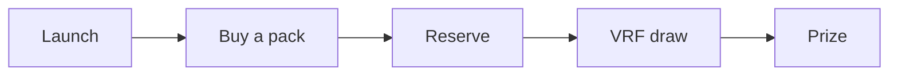

Gabox connects a creator, a market, a buyer, a machine reserve and MagicBlock VRF. This page follows a new coin's machine.

## The flow

1. **Launch.** A creator launches a new coin and its machine in one transaction. The coin uses Gabox's registered Meteora configuration for USDC. The creator pays the seed, which buys the first coins into the machine reserve.
2. **Price.** The buyer picks a pack from a fixed range of USDC prices. How many coins it buys depends on the market price at that moment.
3. **Purchase.** The buyer pays USDC. The market sends the bought coins straight to the machine reserve. 2% of the price is the pack fee. With a referrer, 0.20% of the price goes to the referrer and the rest to Gabox. With no referrer, all of it goes to Gabox.
4. **Reservation.** Gabox takes a snapshot of the prize table and the free coins in the machine reserve. It reserves only this pack's own coins, so other purchases at the same time do not lower its offer. Each purchase is its own draw, so many purchases can run at the same time.
5. **Randomness.** MagicBlock VRF sends 32 random bytes back to Gabox. Gabox turns them into one ticket out of 65,536, and the ticket picks a prize row.
6. **Delivery.** Gabox pays the prize to the buyer's coin account. The machine reserve also pays the 1% transfer fee on top, so the full prize arrives. The prize is capped by what the machine reserve can pay at that moment: if another win settled first, a large prize can be lower than shown. If the buyer's account cannot receive the prize, it is recorded as owed and can be claimed later.
7. **Afterwards.** The buyer keeps the coins or sells them. A sale pays the market's trading fee and the transfer fee, but no pack fee.

## The transfer fee

Every transfer of a new coin pays 1%: buys, sales, wallet transfers, prizes and pool trades. Token-2022 holds the fee in the account that receives the coins. Gabox collects these fees regularly and moves them into the coin's machine reserve. There they pay prizes like any other free coins. See [Transfer fee and graduation](/transfer-fee-and-graduation).

## Graduation

Before graduation, the coin trades on a Meteora DBC bonding curve. A bonding curve is a market whose price rises as coins are bought. Anyone can buy and sell on it: through Gabox packs, on Meteora or in a swap app. When the curve has raised its target, Meteora moves the coin into a DAMM v2 pool, and the largest pack unlocks. The transfer fee stays.

The prize table, the machine reserve and open draws do not change at graduation.

## Older machines

Machines launched before the transfer fee work a little differently. Their coins have no transfer fee. While such a coin is still on its curve, its machine sells no packs. After the coin graduates, the machine sells packs again. See [Deployment status](/status-and-addresses#what-changed).

## The accounting rule

Seed coins, bought coins, collected transfer fees and coins the creator funds all enter the machine reserve. Coins leave it as prizes, with their transfer fee, or as a creator withdrawal of coins the creator funded. Each open draw holds its own pack's coins, and each owed prize holds what it owes. Another draw cannot use them.
