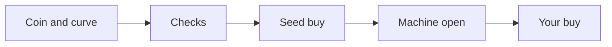

A machine can only open for a brand new coin. The creator launches the coin and its machine in **one transaction**, so nobody can trade the coin before the machine exists.

## What you choose

- **Name, symbol and image.** They go into the coin's own metadata.
- **Top prize.** The largest prize a pack can win: 3×, 5×, 8×, 10× or 20× the pack coins. Each choice comes with its own prize table, and all of them pay back about the same on average. 8× is the default. See [Prizes and odds](/prizes-and-odds#the-apps-tables).
- **Dev buy.** How much USDC you spend at launch, and how much of it is starting liquidity for the machine reserve. The rest buys coins for your own wallet. By default, all of it is starting liquidity. See [Seed and jackpot](/seed-and-jackpot#the-dev-buy).

Everything else is fixed for every coin: USDC as the quote token, 9 decimals, 1,000,000,000 coins, the 1% transfer fee, the trading fees and the move to DAMM v2 at graduation. A client built on the SDK may pass another valid prize table.

## What happens in the launch transaction

1. Meteora DBC creates the Token-2022 coin, with its 1% transfer fee, and its bonding curve. It uses Gabox's registered USDC config.
2. `initialize_pool` checks the config, the coin and the prize table. It refuses a coin that has already traded.
3. `initialize_pool` gives the machine the right to withdraw the coin's transfer fees. From then on only the machine holds it, and it can only move the fees into its own reserve.
4. The seed buy is the coin's first trade. It buys the seed coins straight into the machine reserve.
5. If you keep part of the dev buy, your own buy comes last. It is a normal Meteora buy, and the coins go to your wallet.

If any step fails, nothing happens.

## What it costs

- **The dev buy**, paid in USDC: the starting liquidity, plus your own buy if you keep a part. Both pay the curve's trading fee and the 1% transfer fee, but no pack fee.
- **SOL** for account rent and the network fee.

You sign `max_seed_quote_in`, the most USDC the seed may spend, and `max_seed_native_debit`, the most SOL it may spend. Your own buy has its own floor: the fewest coins you accept. If a limit does not hold, the whole launch fails and nothing happens. The app shows the estimated launch cost before you sign.

## Launch checks

The program checks that:

- the config is the one Gabox registered for USDC, with the Gabox fee terms;
- the coin has 9 decimals, the fixed supply, a 1% transfer fee that nobody can change, and no transfer hook;
- the curve is new and has had no trade;
- the machine reserve is empty before the seed;
- the prize table is valid, and even the smallest possible buy on this curve pays every row at least one coin unit.

## After launch

The coin's market terms and its transfer fee cannot change. The Gabox admin can later raise the prize table, but only to one that pays at least as much on average; a pack already bought keeps the table it was bought under. As creator, you can add more prize coins with `fund_prizes` (Fund prizes in the app). You can take them back later with `withdraw_reserve` (Withdraw prizes): never more than you added, never more than the free coins, and only while no pack is opening and no prize is owed. Only the creator can do either. The seed and the transfer fees never come back. The coins from your own buy are yours to keep or sell.

As creator you earn part of every trade's fee: 0.60% on the curve and 0.30% after graduation, through your locked share of the pool. You do not earn pack fees on your own machine. The transfer fees go to the machine reserve, not to you. See [Referrals and earnings](/referrals-and-earnings).

When the curve reaches its target, the coin graduates. See [Transfer fee and graduation](/transfer-fee-and-graduation).
