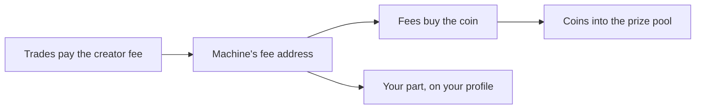

With **Machine recharge**, a creator's trading fees refill their machine's prize pool. The fees buy the machine's coin, and the coins go into the prize pool. The creator turns it on when they launch the machine.

## How it works

1. **Trades pay creator fees.** Every trade of the coin pays a trading fee, and part of it is the creator's. See [Referrals and earnings](/referrals-and-earnings#creator-earnings).
2. **The machine receives them.** The fees go to the machine's own fee address, not to the creator's wallet. This address is a PDA: nobody holds a key for it.
3. **The fees buy the coin.** The prize pool's part of the fees buys the coin on its market: the bonding curve, or the DAMM v2 pool after graduation.
4. **The coins refill the prize pool.** The bought coins go straight into the prize pool. They pay prizes like every other prize pool coin.

## Your choices at launch

- **Machine recharge.** A switch on the launch form. It is off unless you turn it on.
- **The prize pool's part.** All of your creator fees, or only a part. You keep the rest.
- **Where your part goes.** The wallet that claims your part. It cannot change after launch.

You can turn it on only in the launch transaction. An existing machine cannot turn it on, and nobody can turn it off.

## After launch

- **Claim your part.** Your part waits for you on your profile, under "Claim creator fees". It is paid in the machine's quote token. A SOL claim arrives as SOL.
- **Give the prize pool more.** On your profile you can raise the prize pool's part at any time. You can never lower it.
- **The bought coins stay.** Like the seed, nobody can take them out of the prize pool. Withdraw prizes covers only coins you added yourself with Fund prizes.
- **Graduation.** Machine recharge keeps working after graduation. The fees then come from the creator's locked position in the DAMM v2 pool, and they buy the coin on that pool.

## Good to know

- **Anyone can start a refill.** Gabox starts them regularly, but any wallet can. The fees can only buy this coin, and the coins can only go into this machine's prize pool.
- **It depends on trading.** With little trading, the fees are small. Machine recharge does not promise any refill.
- **Only for new coins.** A [Fan coin machine](/fan-coin-machines) cannot use it, because its creator earns no trading fee.
- **The badge.** A Machine recharge machine shows a purple lightning badge on its page.

## Check it on chain

Each Machine recharge machine has a record at the PDA `["machine-feed", machine]`. It holds the prize pool's part, the wallet that claims the creator's part, and running totals of the fees collected, the fees spent and the coins added. Its fee address is the PDA `["machine-feed-authority", machine]`. On a Machine recharge machine, this address is the coin's creator on Meteora.

| Instruction | Who can call it | What it does |
| --- | --- | --- |
| `enable_self_sustaining` | The creator, in the launch transaction | Turns Machine recharge on and makes the fee address the coin's creator on Meteora |
| `collect_curve_fees`, `collect_position_fees` | Anyone | Collect the creator fees from Meteora into the fee address |
| `feed_machine` | Anyone | Buys the coin with the prize pool's part and adds it to the prize pool |
| `claim_creator_share` | The wallet chosen at launch | Pays the creator's part to that wallet |
| `raise_machine_share` | The wallet chosen at launch | Raises the prize pool's part |

## Status

Machine recharge is live on Solana mainnet. The program added it on October 28, 2026. See [Status and addresses](/status-and-addresses).
