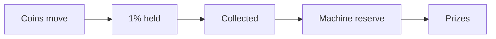

A new Gabox coin starts on a Meteora DBC **bonding curve**: a market whose price rises as coins are bought. Anyone can buy and sell on it: through Gabox packs, on Meteora or in a swap app. Every transfer of the coin pays a 1% **transfer fee**, and the fee goes into the coin's machine reserve.

## The transfer fee

1. **Every transfer pays it.** Buys, sales, wallet transfers, prizes and pool trades each pay 1% of the coins that move. It is a Token-2022 transfer fee, built into the coin itself.
2. **It waits in the receiving account.** Token-2022 holds the fee in the account that received the coins. Nobody can spend it there.
3. **It goes to the machine reserve.** Anyone can collect the fees and move them into the coin's machine reserve. Gabox does this regularly.
4. **It pays prizes.** In the machine reserve, the fees are free coins. They pay prizes like every other free coin.

Good to know:

- The rate is fixed for ever. Nobody can change it, not the creator and not Gabox.
- Only the machine can withdraw the fees, and only into its own reserve. The creator cannot take them out.
- Your prize arrives in full. The machine reserve pays the transfer fee of every prize on top.
- If collection stops for a while, nothing is lost. The fees wait in the accounts until the next collection.

## The graduation target

Gabox's registered Meteora config for USDC sets the **raise**: how much USDC the curve collects before the coin graduates. The create page shows this target before you launch, and the machine page shows the progress. A machine keeps the config it launched with. A later registration only affects new machines.

## The last pack

The curve stops exactly at its target. The pack that reaches it buys only what is left. It may spend less than its price and get fewer coins, and the unused part stays with the buyer.

## When the curve completes

1. **Migrating.** The curve is full. Meteora's migration moves the liquidity into a DAMM v2 pool. The app pauses packs until the pool exists.
2. **Graduated.** The coin now trades in the DAMM v2 pool, and anywhere else it is listed.

After graduation:

- Gabox buys and sells through that DAMM v2 pool. It proves the pool from the pool's own data.
- The largest pack unlocks.
- The trading fee drops from 1% to 0.5%.
- The transfer fee stays at 1%.
- The pool's liquidity is locked for ever. The creator owns 75% of the locked position and Gabox 25%.

The prize table, the machine reserve, open draws and referral links carry on unchanged.

## Older coins

Coins launched before the transfer fee have no transfer fee. They carry the Gabox transfer hook instead. The hook used to let only Gabox buy on the curve. It now blocks nothing, and Meteora removes it at graduation.

- **On the curve.** The machine sells no packs, and its gifts wait. Holders can still sell, and the creator can still withdraw the prize coins they funded.
- **After graduation.** The machine sells packs again, with no transfer fee. Older graduated coins, such as \$GABOX, work as before.

Older coins also keep the trading fees they launched with. See [What a pack costs](/what-a-pack-costs#trading-fees).
